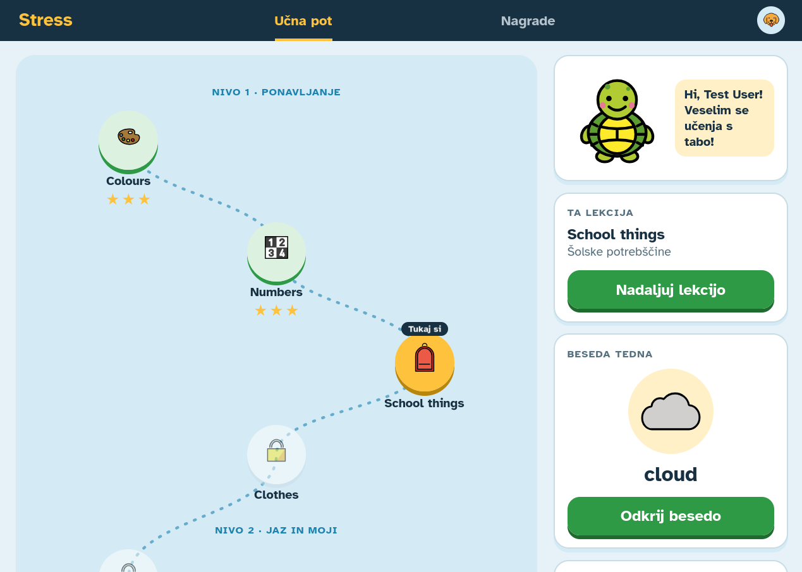

<p align="center">
  
</p>

# Stress 🐢

Stress is a web application that helps Slovenian primary-school pupils,
particularly around Grade 4, learn English through vocabulary games and
listening activities.

Learners explore lessons with Tobi the turtle, track their progress,
and earn rewards to personalize their experience.

<p align="center">
  
</p>

## ✨ Features

- 🗺️ **Learning roadmap:** 12 lessons with 8 vocabulary words each.
- 🎮 **Four activities in every lesson:**
  - **Match:** connect English words with their meanings.
  - **Memory:** match words and pictures in a memory game.
  - **Listening:** listen to a word and select the matching picture.
  - **Fill in the Blank:** complete missing words.
- 📅 **Word of the week:** 52 weekly seasonal vocabulary entries with short
  usage examples.
- 🔊 **Pronunciation audio:** AI-generated pronunciations for the vocabulary
  used in the app.
- ⭐ **Results and progress:** feedback after activities and star-based lesson
  results. Match, Listening, and Fill in the Blank award 1–3 stars based on
  mistakes; these results are averaged to determine the lesson's stars.
  Memory does not contribute to the star rating. Learners can earn up to
  36 lesson stars in total.
- 🐾 **Profiles and avatars:** email-linked profiles with a choice of more than
  15 animal-themed avatars. Some are available immediately, while others
  unlock through collected stars.
- 🐚 **Rewards and store:** learners earn seashells by completing lessons and
  can spend them on app themes and avatar decorations.

## 🛠️ Technology stack

- React
- Vite
- TypeScript
- CSS
- Firebase Authentication
- Cloud Firestore

## 🚀 Development

Requires Node.js 24, npm 11, and Java 21.

```sh
npm ci       # once after cloning, or when dependencies change
npm run dev
```

This starts Auth and Firestore emulators, creates the test user, and starts
the app in one terminal. Stop with Ctrl+C; emulator data is saved for next time.

- **Test user:** `test@example.com` / `test-password`
- **Emulator UI:** http://127.0.0.1:4000
- **Reset data:** stop the app and delete `.firebase/emulator-data/`.

### 🔥 Firebase environment

`.env.development` selects local emulators; `.env.production` selects live
Firebase.

To override either, set `VITE_USE_FIREBASE_EMULATORS=true` (local) or `false`
(live) in `.env.local`, then restart Vite or rebuild.

To run just the app without starting emulators:

```sh
npm run dev:app
```

### 🎧 Recorded audio

All speech uses local [ElevenLabs](https://elevenlabs.io) recordings. Set `ELEVENLABS_API_KEY` in `.env.local`, then run:

```sh
npm run audio:generate
```

Only missing recordings are generated. To replace existing recordings, use
`npm run audio:generate -- --word red --force`,
`npm run audio:generate -- --sentence colours/colours-1 --force`, or `--all --force`.
Without `--force`, `--word` and `--sentence` also let you generate a single missing
recording. The default checks/generates both vocabulary and grammar recordings.
Change `VOICE_ID` near the top of `scripts/generate-audio.mjs` to switch voices.

`npm run audio:check` reports missing recordings or changes to the text, voice,
or model without calling the API (exit status 1 if anything needs updating).
The settings for each recording are saved in `scripts/audio-manifest.json`.

### ✅ Checks

- `npm run check` - formatting, linting, and build.
- `npm run format` - format files.

## 🔗 Sources and acknowledgements

Third-party assets remain subject to their respective licenses and terms.
The references below do not imply endorsement by their authors or publishers.

### Atkinson Hyperlegible - font

The application uses
[Atkinson Hyperlegible](https://fonts.google.com/specimen/Atkinson+Hyperlegible?preview.script=Latn),
a typeface developed for the Braille Institute with an emphasis on
distinguishing letterforms and improving readability.

- **Source:** Google Fonts.
- **License:** SIL Open Font License 1.1.
- **Project and license information:**
  [Atkinson Hyperlegible font project](https://github.com/googlefonts/atkinson-hyperlegible).

### OpenMoji - emoji illustrations and icons

Most emoji illustrations and icons used in the application are from
[OpenMoji](https://openmoji.org/), an open-source emoji project.

- **Credit:** OpenMoji contributors.
- **License:**
  [Creative Commons Attribution-ShareAlike 4.0 International
  (CC BY-SA 4.0)](https://creativecommons.org/licenses/by-sa/4.0/).

### ElevenLabs - generated pronunciation audio

Word-pronunciation audio was generated using
[ElevenLabs](https://elevenlabs.io/) text-to-speech technology.

### 📚 Learning-content and design references

The following sources informed vocabulary selection, lesson planning, and
child-focused interface design. The app is not a complete official curriculum.

<details>
<summary>View learning-content and UX/UI references</summary>

#### Learning content

- **Cambridge Assessment English:** [Pre A1 Starters word list (2018)](https://www.cambridgeenglish.org/images/351849-pre-a1-starters-word-list-2018.pdf).
- **Eurydice:** [Poučevanje in učenje v osnovnošolskem izobraževanju (2026)](https://eurydice.eacea.ec.europa.eu/sl/eurypedia/slovenia/poucevanje-ucenje-v-osnovnosolskem-izobrazevanju).
- **Slovenian national curricula:**
  [Tuji jezik v 1. razredu (2024)](https://www.gov.si/assets/ministrstva/MVI/Dokumenti/Osnovna-sola/Ucni-nacrti/obvezni/TUJI-JEZIK-V-1.-RAZREDU-2024.pdf);
  [Tuji jezik v 2. in 3. razredu (2013)](https://www.gov.si/assets/ministrstva/MVI/Dokumenti/Osnovna-sola/Ucni-nacrti/obvezni/UN_TJ_2._in_3._razred_OS.pdf);
  [Tuji jezik – angleščina (2025)](https://www.gov.si/assets/ministrstva/MVI/Dokumenti/Osnovna-sola/Ucni-nacrti/Ucni-nacrti/2025/UN_OS/Ucni_nacrt_tuji_jezik_-_anglescina_2025.pdf);
  [Didaktična priporočila (2025)](https://www.gov.si/assets/ministrstva/MVI/Dokumenti/Osnovna-sola/Ucni-nacrti/Ucni-nacrti/2025/UN_OS/Didakticna_priporocila_k_ucnemu_nacrtu_tuji_jezik_anglescina_2025.pdf).
- **Mladinska knjiga - annual teaching plans:**
  [Rainbow Bridge 2](https://mladinska-knjiga.si/wp-content/uploads/2026/04/rainbow_bridge_2.pdf),
  [Rainbow Bridge 3](https://mladinska-knjiga.si/wp-content/uploads/2026/04/rainbow_bridge_3_0.pdf),
  [Rainbow Bridge 4](https://mladinska-knjiga.si/wp-content/uploads/2026/04/rainbow_bridge_4.pdf).

#### UX/UI design

- **Feifei Liu, Nielsen Norman Group:**
  [Designing for kids: Cognitive considerations (2018)](https://www.nngroup.com/articles/kids-cognition/);
  [Designing for children (2019, video)](https://www.nngroup.com/videos/designing-children/).
- **Catalina Naranjo-Bock, UXmatters:**
  [Typography in applications for children (2011)](https://www.uxmatters.com/mt/archives/2011/06/effective-use-of-typography-in-applications-for-children-3.php);
  [Color and graphics for ages 7–14 (2011)](https://www.uxmatters.com/mt/archives/2011/12/effective-use-of-color-and-graphics-in-applications-for-children-part-ii-kids-7-to-14-years-of-age.php).
- **Philip Osborne, UXmatters:**
  [UX design for kids: Key design considerations (2020)](https://www.uxmatters.com/mt/archives/2020/01/ux-design-for-kids-key-design-considerations.php).
- **Brian Livingston, InfoWorld:**
  [Many Web sites aren’t designed well for kids (2002)](https://www.infoworld.com/article/2225267/many-web-sites-aren-t-designed-well-for-kids.html).

</details>
